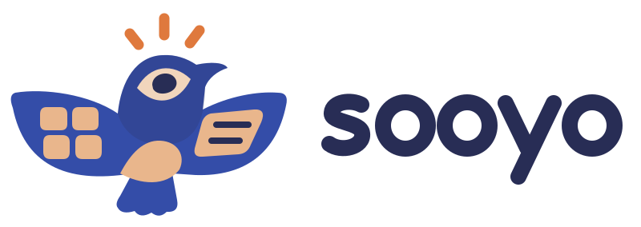

<p align="center">
  <picture>
    <source media="(prefers-color-scheme: dark)" srcset="./assets/brand/logo-reversed.svg" />
    
  </picture>
</p>

<h1 align="center">sooyo daily</h1>

<p align="center"><a href="./docs/brand.md">Brand guidelines &amp; logo assets (Chinese)</a></p>

<p align="center"><b>A composable, local-first personal space for <a href="https://github.com/deepseek-ai/deepseek-harness">DeepSeek Harness</a> —
the page you open each day to see what to do, what is worth reading, and where your projects stand.</b></p>

<p align="center">
  <a href="./README.md">简体中文</a>
  ·
  English
</p>

<p align="center">
  <a href="https://github.com/deepseek-ai/deepseek-harness">= 0.2.0-rc.1"></a>
  <a href="./LICENSE"></a>
  
  
</p>


---

A **sooyo daily** entry appears in the DSH sidebar. Opening it shows your homepage: Board segments, a command bar and a greeting on top, then a packed bento grid where each cell is a Widget.

The model is one sentence: **a Board holds Widgets, a Widget is an instance the user placed, and a Source only supplies Items.**

## Highlights

- **Two layers, Board and Widget.** 总览 / 工作 / 生活 / 阅读 ship as Boards and you can make your own; the same Widget Type can appear several times, each with its own sources, 呈现 and Size.
- **The Widget Type selects the renderer; the Size selects the information level.** S / M / L / Wide are four levels of detail, not one card stretched; each type declares only the Sizes it actually supports.
- **One 订阅 Widget covers five 呈现** — 图文 / 榜单 / 论文 / 产品 / 视频 — so adding a source needs no client code. A Source only *suggests* a default.
- **卡片流 (Deck).** One Item at a time, drag to sort (right = Read Later, left = skip), a paper card that flips to its abstract, auto-advance at S size, and arrow-key control.
- **关注词.** Items whose title, summary, one-liner or 推荐理由 match a keyword are marked, and `关注优先` sorting floats them up.
- **Missing covers are read off the page.** AIHOT and Product Hunt publish no image with their items, so the Host reads `og:image` from the page each Item links to — **once per page**, only the first 160 KB, cached forever; a page with no image is remembered so it is never requested again.
- **Personal data lives on the DSH storage domain.** Boards, layouts, Tasks, Notes, Read Later, 关注词, habits and the focus timer all persist across processes and machines.
- **Zero dependencies, no build step** — plain JavaScript, so the package installs and runs as-is.
- **Its own fetch layer**: per-source cadence, conditional requests (ETag/304), a global concurrency cap, and proportional retry (1/2/4… minutes) so one failing source never affects the others.
- **Fetched content is data, never instructions** — every item carries its source and original link.
- **Model-visible too**: `sooyo_brief`, `sooyo_refresh`, and `sooyo_sources` tools, which pair with DSH's own scheduler for a daily digest.

## Sources

| Source | Default 呈现 | Cover | Cadence |
|---|---|---|---|
| [AIHOT](https://aihot.news) selected | 图文 with score and 推荐理由 | `og:image` off the article page | 10 min |
| AIHOT hot topics | 榜单 (multi-source top 10) | none — the rank number is the visual | 30 min |
| [HuggingFace papers](https://huggingface.co/papers) | 论文 with a one-line summary, keywords, votes/comments | HuggingFace CDN or the teaser figure | 6 h |
| [Product Hunt](https://www.producthunt.com) today | 产品: monogram tile + tagline | `og:image` off the product page | 3 h |
| YouTube · [Dwarkesh Patel](https://www.youtube.com/@DwarkeshPatel) | 视频: 16:9 episodes, a 9:16 Shorts shelf | YouTube thumbnails | 3 h |
| YouTube · [Dwarkesh Patel](https://www.youtube.com/@DwarkeshPatel) | 16:9 cover + play badge | 3 h |

## Install

Requires [DeepSeek Harness](https://github.com/deepseek-ai/deepseek-harness) `>=0.2.0-rc.1` and Node.js `>=20`.

```sh
dsh plugin --profile web add dsh-sooyo
```

Install the official npm package. Follow DSH's activation result: native updates
prefer HMR and explicitly report when a restart is required.

The top-bar update button checks stable npm releases and installs only after a human click. Each DSH
instance upgrades independently. Unsubmitted drafts block activation; accepted writes and the Client
Outbox persist before shutdown. Both the local Host and browser builds are verified after activation.
Source checkouts stay read-only, and GitHub/local package installs require a one-time switch to npm.
Hosts without the native API keep read-only checks. See [plugin updates](./docs/plugin-updates.md).

## Configuration

`config` in `cordis.patch.yml`:

| Field | Default | Meaning |
|---|---|---|
| `mode` | `selected` | AIHOT feed: `selected` (editor's picks) or `all` |
| `sources` | all | Only enable the listed source ids |
| `refreshMinutes` | — | Override every source's cadence |
| `thumbnailBatch` | `6` | Pages read per pass while filling in covers (max 20) |

Disabling a source is a matter of editing the `SOURCES` registry in `index.js` — that registry is the single source-extension point.

## Adding a source

```js
{
  id: 'my-source',
  label: 'My source',
  cadenceMinutes: 180,
  suggests: { pres: '图文' },   // only a default for a newly added 订阅 Widget
  async load(signal, previous) {
    // return { items: [{ nativeId, title, url, publishedAt, summary, score, category, origin }], etag }
  },
}
```

A source no longer declares a card: it supplies Items and suggests a 呈现. Layout, Size and which Board it lives on are user data.

## Development

```sh
npm run check         # syntax check the five modules
npm run test          # full self-test (fetches all five sources and asserts the fields the new cards read)
npm run test:offline  # offline fixtures, the personal-data surface, and structural assertions (what CI runs)
```

`dev/selftest.mjs` runs the real `apply()` against a fake context and drives its own HTTP route with fake `req`/`res`. Because a Host change needs a restart to take effect, testing the logic locally is far faster than restarting repeatedly.

Architecture and the trade-offs behind it: [`docs/adr/`](./docs/adr/), [`docs/sync.md`](./docs/sync.md), [`docs/ui-and-layout.md`](./docs/ui-and-layout.md), and [`docs/sources.md`](./docs/sources.md); vocabulary: [`GLOSSARY.md`](./GLOSSARY.md).

## Data and compliance

- Content belongs to its original sources; this plugin only aggregates it for personal, non-commercial use.
- [AIHOT](https://aihot.news) explicitly permits personal non-commercial use; `attribution` and original links are preserved. See <https://aihot.news/terms>.
- Fetched third-party text is treated as data and is **never executed as instructions**.
- Respect each site's robots and terms; the default cadences follow the published cache and rate-limit guidance.

## License

[MIT](./LICENSE)
