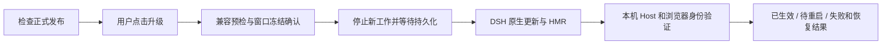

# 插件检查、升级与重新加载

sooyo 的正式版本通过 npm 分发，每个 DSH 实例独立检查和升级。顶部的「插件更新」入口展示本机服务、
浏览器界面和磁盘安装版本；后台只检查，用户点击升级后才调用 DSH 原生 PluginManager。
架构取舍见 [ADR 0004](./adr/0004-host-managed-plugin-upgrades.md)。

## 使用边界

- **正式包一键升级。** 当前 profile 以自身包名安装的 npm 包，且宿主提供 `listVersions` / `updateBundle`
  时才提供一键升级。默认只选择更高的正式版本，预发布版不进入候选。
- **源码副本只检查。** Git 工作树另报开发提交差异，界面不拉取、构建或修改仓库。已有 `github:`、
  tarball 或本地路径安装需要在 DSH 插件管理器中切换为 npm 安装；不会自动转换。
- **各实例独立。** 升级 Client 只替换这个 Client 所在 DSH 的 sooyo，不连带升级 Hub 或其他设备。
  插件版本与个人数据的 **Revision** 不同。
- **保护未提交内容。** 所有已连接面板必须报告无草稿、无正在提交的写入，并确认编辑界面已冻结后，
  才准备激活。未响应的窗口会阻止升级，需重新打开或关闭后重试。
- **第一版只做兼容升级。** 目标发布必须声明与当前相同的数据结构、同步协议及 Outbox 格式；
  Client 还需确认当前 Hub 可连接且兼容。无法确认时暂缓，不执行数据迁移。
- **优先 HMR，必要时待重启。** 原生管理器决定安装是否已经激活；需要重启时展示已安装版本与运行
  版本的差异，用户安排 DSH 重启。sooyo 不自动重启宿主。
- **原生尽力恢复。** 目标失败后由 DSH 尝试重新安装旧包；升级和恢复结果分别显示。恢复也失败时，
  即使 sooyo 面板消失，浏览器中的结果接收者仍提供故障提示和原生插件管理器的恢复指引。
  恢复旧包不撤销个人数据，也不保证断网时能恢复。

## 模块与调用归属

| 模块 | 职责 |
|---|---|
| `src/shared/build.ts` / `updates.ts` | Host / 浏览器共同构建身份、发布兼容契约和更新状态 |
| `src/host/updates/service.ts` | 有 TTL 和强制刷新的检查、npm 元数据预检、面板登记和激活准备 |
| `src/host/core/lifecycle.ts` | 工作准入、在途任务和异步持久化跟踪、暂停与关闭 |
| `src/client/updates/session.ts` | 草稿/提交检查、跨面板卸载保留的调用和最小回执、运行版本验证 |
| `src/client/updates/PluginUpdates.tsx` | 更新入口、说明、进度及失败结果 |
| DSH PluginManager | package/profile 变更、Host 模块替换、激活和旧包恢复尝试 |

浏览器通过可选的 `remote` / `remote.pluginManager` 服务注入调用原生 updater；旧宿主缺少服务时仍可打开面板。
安装不经过 sooyo 自己的长时间 HTTP 请求。Remote contribution 属于独立的宿主插件，sooyo 自卸载
不会自动取消已发出的调用。升级不进入个人数据命令集或 Hub 同步 API，Agent 工具仍然只检查版本。

## 安全卸载

`RuntimeLifecycle.run()` 保留已经接受的工作继续执行的资格，同时拒绝暂停后的新工作。它跟踪嵌套的
异步写入，已经结束的作用域不能通过遗留定时器继续获得写权限。关闭时先停止新工作、取消可中断的
抓取，等待所有已接受工作和持久化，再关闭存储；最后才清除 domain 和 ready 状态。

Host 服务、HTTP、Agent 工具、后台抓取、Review 和 Client 缓存均在此边界内。Source 和缩略图的写入
也经现有队列串行提交。Client Outbox 发送使用单个在途 flush，离线投影等待本地持久化后才返回；
升级保留 Outbox 原 operationId，不要求 Hub 已收完所有待发命令。

激活准备请求本身不在等待集合中，避免等待自己的死锁。准备失败会解除暂停；没有发生替换且发起
窗口丢失时，准备租约最终释放旧实例。真正卸载时的异步 disposer 会等待关闭完成。

## 本机身份与结果

- `GET /sooyo/runtime` 对全部角色返回**本机** Host 构建、实例 ID、就绪状态及生命周期阶段。
  Client 的 `/meta` 可能来自 Hub，不能用它验证本机激活。
- `GET /sooyo/updates` 读取缓存；`POST /sooyo/updates/check` 强制检查。其余 `/updates/*` 仅协调
  当前浏览器面板及准备/恢复，不安装包。控制请求要求 loopback 和当前界面的请求头。
- 正式发布的身份是 semver；commit 标识代码来源。Host / 浏览器同时内嵌 `{version, commit, dirty, builtAt}`，
  同 semver 不代表同构建。浏览器写入携带身份，Host 拒绝版本不一致的界面写入。
- DSH `applied` 只证明宿主装配成功。sooyo 还验证自身存储就绪及 Host / 浏览器构建一致后才显示已生效。
- 原生完整升级结果没有持久化重取接口。浏览器保存不含令牌的最小回执；刷新或断连丢失结果时显示
  「尚未确认」，再核对实际运行身份。不会通过磁盘版本、安装成功或缺少回执推断成功。

## 宿主能力

Desktop / npm CLI `0.2.2-rc.1` 提供原生正式包升级和 HMR。CLI `0.2.1-rc.5` 有 Host HMR，其
PluginManager 类型声明缺少上述更新接口；最低声明版本 `0.2.0-rc.1` 不保证同样能力。运行时按可用
服务和方法探测，不能仅按 DSH 版本号或「有 HMR」推断能一键升级。

原生更新只接受当前 profile 的第三方 registry dependency、精确的更高 semver，并检查 DSH 要求。
`github:`、`link:`、tarball 和 alias 都不属于该接口的可更新形态。`application` / `restartReason`
决定激活结果；有 HMR 时会主动处理 Node 模块缓存，所以 Host 变化并非一律需要重启。

## 配置与正式发布

`config.updates.autoCheck` 默认开启；`config.updates.registry` 可指定不带凭据的 registry URL。
正式发布默认使用公共 npm；本地 HTTP loopback registry 用于隔离测试。关闭 `upstream.context`
只关闭 AIHOT 和更新信息的 Context Bridge 提示，不关闭正式版本后台检查。

发布包的 `sooyo.updateContract` 必须与代码一致，`sooyo.releaseNotes` 提供界面说明。
`dev/verify-release.mjs` 核对 npm / DSH manifest / 两个运行 bundle 的版本、共同构建身份及兼容契约；
正式发布校验还要求干净源树、源 commit 和正确的版本 tag。生成的根 bundle 不计作源树修改。
干净构建使用源 commit 的时间作为固定构建时间戳；同一 tag 重跑可生成相同的包。
发布脚本同时核对压缩包内的 bundle 与已验证构建，发布后校验 npm 完整性；已经存在的版本只有内容
完全一致才视为成功，不覆盖同版本的不同产物。
首次发布后 npm 可能暂时返回 404；脚本会有界等待公开可见，再验证完整性。权限错误、其他查询错误和
不同内容仍立即失败；CI 重跑会替换同名构建 artifact，不重复发布已验证的同一版本。

沿用一个 CI Workflow / Ubuntu Job，普通分支执行快速检查；版本 tag 额外完成真实 DSH smoke、打包、
保存包与截图，然后使用 npm trusted publishing 发布。首次发布需要 npm 包所有者身份，之后在 npm 配置
`CaiZongyuan/dsh-sooyo` 的 `.github/workflows/ci.yml` 为 trusted publisher。实现和检查不会创建 tag 或发布包。
也可配置仓库 Actions secret `NPM_TOKEN`：CI 使用它进行发布，未配置时使用 OIDC。token 需要对应包的
发布权限，并满足 npm 的 2FA 发布要求；CI 不将 token 写进产物或日志。

## 验证

- `dev/update-selftest.mjs` 由现有离线 runner 调用：工作准入/持久化、缓存强制刷新、正式版本筛选、
  错误与兼容阻断、多窗口冻结和旧宿主只读行为。
- `tests/e2e/updates.spec.ts` 使用真实 DSH 和本地 npm registry 中的真实打包产物，覆盖升级、草稿、
  两个 bundle 身份、数据保留、目标失败恢复、恢复失败及待重启。
- 通过 `DSH_E2E_BIN` 指定具备更新 API 的 DSH CLI 入口；测试缺少能力时应报错，不能跳过或用假安装
  证明热重载。UI / Sync / Storage 验证继续遵循 [`testing.md`](./testing.md)。
